

  
  <a href="#selected-projects"></a>
  <a href="#activity"></a>
  <a href="#about"></a>
  <a href="#contact"></a>
  
  
  <a href="https://github.com/Mingrui-Ai/EchoSoul"></a>
  
  
  <a href="https://github.com/Mingrui-Ai/linuxdo-android"></a>
  
  
  <a href="https://github.com/Mingrui-Ai?tab=overview">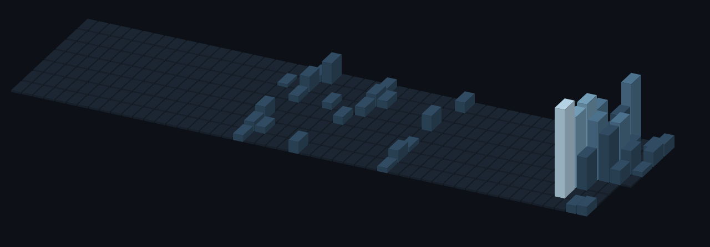</a>
  
  
  
  <a href="https://github.com/Mingrui-Ai/Mingrui-Ai/actions/workflows/deepwater.yml">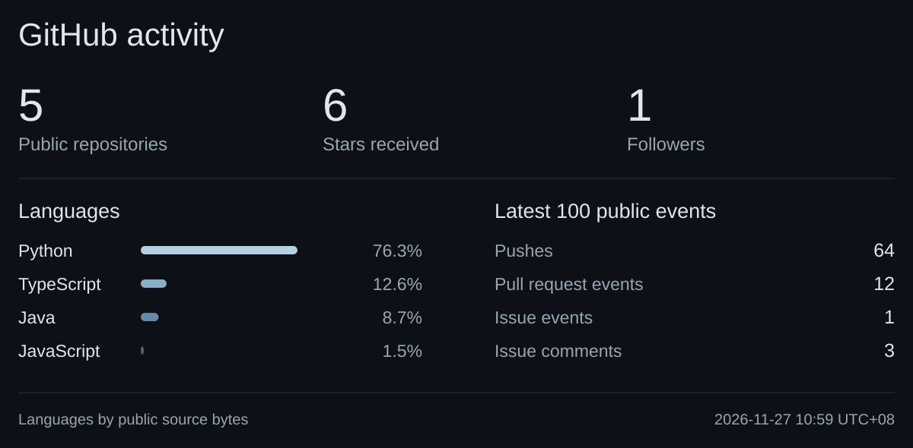</a>
  
  
  
  

关于我与项目 / About & project notes

你好，我是 **艾明睿 (Mingrui Ai)**，就读于 **华南农业大学 · 计算机科学与技术**。
专注计算机科学与人工智能，热衷于把想法做成高效、智能的软件。

A Computer Science & AI explorer at **South China Agricultural University**, building efficient and intelligent software solutions.

- **目前关注 / Focus**：大语言模型应用集成 · AI Agents · 全栈开发。
- **技术栈 / Tools**：Java · Python · C/C++ · SQL · Vue 3 · TypeScript · Git · Docker。
- **[EchoSoul](https://github.com/Mingrui-Ai/EchoSoul)**：JavaFX 桌面聊天应用，支持人格驱动对话、可插拔 LLM、本地历史记录和可选语音能力。
- **[AI Job Search CN](https://github.com/Mingrui-Ai/ai-job-search-cn)**：基于 [ai-job-search](https://github.com/ai-job-search-dev/ai-job-search) 的中国招聘市场适配，仍在开发中。
- **[lil-seal](https://github.com/Mingrui-Ai/lil-seal)**：一个关于小海豹的 JavaScript 网页实验。
- **[LinuxDo Android](https://github.com/Mingrui-Ai/linuxdo-android)**：Fork 自 [xuemk/linuxdo-android](https://github.com/xuemk/linuxdo-android)，探索 Kotlin 与 Android 社区客户端。

  <a href="https://github.com/Mingrui-Ai?tab=repositories">All repositories ↗</a>&nbsp; · &nbsp;
  <a href="mailto:mingrui.ai@outlook.com">Email ↗</a>&nbsp; · &nbsp;
  <a href="#selected-projects">Back to the surface ↑</a>

DEEPWATER / VOL.02 · Visual study inspired by <a href="https://unseen.co/projects/">Unseen Studio</a> · Original artwork, real projects. Daily visuals: <a href="https://github.com/yoshi389111/github-profile-3d-contrib">3D Contrib</a> · <a href="https://github.com/Platane/snk">snk</a> · <a href="https://github.com/lowlighter/metrics">Metrics</a> · <a href="https://github.com/Mingrui-Ai/Mingrui-Ai/actions/workflows/deepwater.yml">Update status</a>

