  
  
  
  
  
  
  
  
  
  

关于我与项目 · About & projects

我是 **艾明睿 (Mingrui Ai)**，就读于 **华南农业大学 · 计算机科学与技术**，关注大语言模型、AI Agents 与全栈开发。

Computer Science at **South China Agricultural University**, exploring LLMs, AI agents and full-stack development.

- **Tools**：Java · Python · C/C++ · SQL · Vue 3 · TypeScript · Git · Docker。
- **[EchoSoul](https://github.com/Mingrui-Ai/EchoSoul)**：JavaFX 桌面聊天应用，支持人格驱动对话、可插拔 LLM、本地历史和可选语音。
- **[AI Job Search CN](https://github.com/Mingrui-Ai/ai-job-search-cn)**：基于 [ai-job-search](https://github.com/ai-job-search-dev/ai-job-search) 的中国招聘市场适配，开发中。
- **[lil-seal](https://github.com/Mingrui-Ai/lil-seal)**：关于小海豹的 JavaScript 网页实验。
- **[LinuxDo Android](https://github.com/Mingrui-Ai/linuxdo-android)**：Fork 自 [xuemk/linuxdo-android](https://github.com/xuemk/linuxdo-android)，探索 Kotlin 与 Android 社区客户端。

[全部仓库 / All repositories ↗](https://github.com/Mingrui-Ai?tab=repositories)

数据与更新 · GitHub activity

[自动更新记录](https://github.com/Mingrui-Ai/Mingrui-Ai/actions/workflows/deepwater.yml) · [设计与生成说明](assets/profile/ARTWORK.md)

视觉灵感来自 [Unseen Studio](https://unseen.co/projects/)，插画为原创。贡献图由 [3D Contrib](https://github.com/yoshi389111/github-profile-3d-contrib) 与 [snk](https://github.com/Platane/snk) 生成；数据面板使用 GitHub 公开数据或已配置的 [Metrics](https://github.com/lowlighter/metrics)。

