  

  <a href="#about">Index / 关于</a>&nbsp;&nbsp;&nbsp;·&nbsp;&nbsp;&nbsp;
  <a href="#selected-projects">Projects / 项目</a>&nbsp;&nbsp;&nbsp;·&nbsp;&nbsp;&nbsp;
  <a href="#contact">Contact / 联系</a>

  

  
  

  
  

<a href="https://github.com/Mingrui-Ai?tab=repositories">Explore all repositories ↗</a>

项目说明 / Project notes

- **[EchoSoul](https://github.com/Mingrui-Ai/EchoSoul)** — 基于 JavaFX 的桌面聊天应用，支持人格驱动对话、可插拔 LLM 接入、本地历史记录与可选语音能力。
- **[AI Job Search CN](https://github.com/Mingrui-Ai/ai-job-search-cn)** — 基于 [ai-job-search](https://github.com/ai-job-search-dev/ai-job-search) 的中国招聘市场适配；聚焦中文 JD 解析、证据校验和可解释匹配，仍在开发中。
- **[lil-seal](https://github.com/Mingrui-Ai/lil-seal)** — 一个关于小海豹的 JavaScript 网页实验。
- **[LinuxDo Android](https://github.com/Mingrui-Ai/linuxdo-android)** — Fork 自 [xuemk/linuxdo-android](https://github.com/xuemk/linuxdo-android)，探索 Kotlin 与 Android 社区客户端。

### A little about me / 关于我

你好，我是 **艾明睿 (Mingrui Ai)**，就读于 **华南农业大学 · 计算机科学与技术**。
专注计算机科学与人工智能，热衷于把想法做成高效、智能的软件。

A Computer Science & AI explorer at **South China Agricultural University**, building efficient and intelligent software solutions.

| Currently exploring / 目前关注 | Tools I work with / 技术栈 |
| :--- | :--- |
| LLM integration · AI agents · Full-stack development | Java · Python · C/C++ · SQL |
| 大语言模型应用集成 · 智能体 · 全栈开发 | Vue 3 · TypeScript · Git · Docker |

GitHub stats & activity / 统计与动态

  
  

  

  <a href="https://github.com/Mingrui-Ai">GitHub ↗</a>&nbsp;&nbsp;·&nbsp;&nbsp;
  <a href="mailto:mingrui.ai@outlook.com">Email ↗</a>&nbsp;&nbsp;·&nbsp;&nbsp;
  <a href="#selected-projects">Back to projects ↑</a>

Visual study inspired by <a href="https://unseen.co/projects/">Unseen Studio</a> · Original SVG artwork, personal projects.

